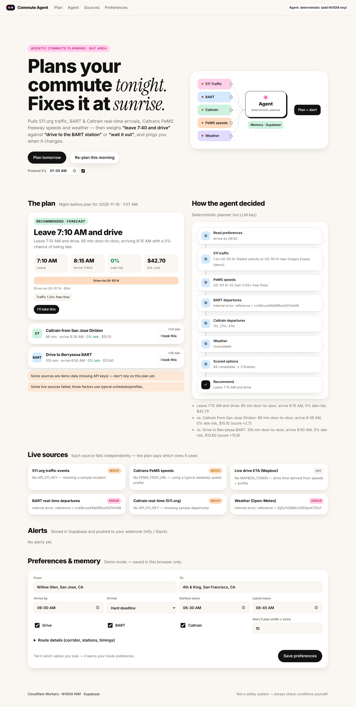

# Agentic Commute Planner

Created and owned by **CHANDAN DAS**. © 2026 CHANDAN DAS. All rights reserved. See [LICENSE](LICENSE).

Plans your Bay Area commute **the night before** and **re-plans it in the morning** from live data.
It compares options like "leave 7:40 and drive", "drive to the BART station" and "wait until 9:15",
and pushes alerts such as *"US-101 N is backing up. Leave 15 minutes early (7:25 AM), or take Caltrain at 7:32 AM."*



- **Runtime:** Cloudflare Workers (static UI in `public/` + API in `src/`, plus a cron trigger)
- **LLM:** NVIDIA NIM (OpenAI-compatible chat completions with tool calling)
- **Memory and storage:** Supabase (Postgres + Auth). Without it the app runs in browser-only demo mode.
- **Data:** 511.org traffic + Caltrain, BART real-time ETD, Caltrans PeMS speeds (through a feed you supply), Open-Meteo weather, optional Mapbox live ETA

## Using it

1. **Your commute:** enter the start and destination addresses, arrive-by time, the earliest and latest you'd leave, and your workdays. Addresses are geocoded (Mapbox if `MAPBOX_TOKEN` is set, otherwise OpenStreetMap Nominatim), and the no-traffic drive time is estimated from distance. You can edit that estimate.
2. **Your stations:** pick where you'd board and get off for BART, Caltrain and/or ACE from the dropdowns.
   - **BART:** the ride time and the train lines to board come from BART's trip planner.
   - **Caltrain:** the right 511 platform stop code (north/southbound) and a rough ride time are filled in for you.
   - **ACE:** ACE runs only a few morning trains, so enter the train times at your boarding station (from acerail.com). The ride time is estimated from the stations. For live ACE times, set a 511 key and the 511 stop code (agency `CE`).
   - **Your own times:** add your drive-to-station and walk times.
3. Press **Save & plan tomorrow** (the night-before plan), then **Save & re-plan now** in the morning.

## How it works

```
cron (every 10 min) / button ─▶ gatherSnapshot()  ── 511 · BART · Caltrain · PeMS · weather · Mapbox (parallel, cached, each fails independently)
                                     │
                                     ▼
                              buildOptions()       ── deterministic: every mode × departure time (5-min steps)
                                     │                 traffic profile × live anomaly, incidents, rain, next train,
                                     │                 miss-the-train risk → late-risk, cost, score
                                     ▼
                              runAgent()           ── NVIDIA model calls tools (get_traffic_incidents, get_transit_departures,
                                     │                 get_weather, evaluate_options …) and must pick one of the scored option ids
                                     ▼
                              computeAlert()       ── morning vs night plan: mode switch / leave N min early / later, with hysteresis
                                     │
                         Supabase (plans, alerts, feedback, prefs) + webhook (ntfy / Slack)
```

**Guardrail:** the LLM explains the plan and chooses among options the planner has computed. It never
invents times. If the key is missing, the API fails or times out, or the model returns an unknown
option, the app falls back to the deterministic recommendation and shows this in the trace.

**Memory:** the "I took this" button records feedback and shifts a learned `modeBias` in your
preferences. That bias feeds into every later score.

## Run locally

```bash
npm install
```

```bash
cp .dev.vars.example .dev.vars   # fill in whatever keys you have; all are optional
```

```bash
npm run dev                      # http://localhost:8787
```

```bash
npm test && npm run typecheck
```

Behind an HTTPS proxy (corporate network, cloud sandbox)? The local Worker runtime (workerd) ignores `HTTPS_PROXY`, so outbound API calls fail with "internal error". Run the same Worker code in Node instead:

```bash
npm run dev:node
```

With no keys, the app still runs. Sources show **MOCK / ERROR / OFF** badges, and the plan warns you not to rely on it.

## Deploy to Cloudflare

1. `npx wrangler login`
2. Optional but recommended, a KV cache: `npx wrangler kv namespace create CACHE`, then uncomment the block in `wrangler.toml`.
3. Add each secret: `npx wrangler secret put NVIDIA_API_KEY` (repeat for every key in `.dev.vars.example`).
4. In Supabase, run `supabase/schema.sql` in the SQL editor. Enable the Email (magic link) provider and add your Worker URL to the auth redirect URLs.
5. Run `npm run deploy`.

## Data source notes

| Source | Access | Notes |
|---|---|---|
| 511.org traffic events + Caltrain StopMonitoring | Free key from 511.org/open-data/token | Default quota is about 60 requests/hour per key. Responses are cached for 5 min (traffic) and 90 s (Caltrain). Request a higher limit before going multi-user. |
| BART ETD | Public demo key built in | Register your own key for production. Station codes are abbreviations (`DUBL`, `BERY`, `MONT`, …). |
| Caltrans PeMS | **No public real-time API** (account + 5-min station files) | Set `PEMS_FEED_URL` to a JSON feed you produce: `{"corridors":{"US-101 N":{"speedMph":34,"freeFlowMph":65}}}`. Without it, a typical weekday speed profile is used (marked MOCK). |
| ACE | Timetable you enter, or 511 StopMonitoring (agency `CE`) with a stop code | The default Tracy times are approximate placeholders. Verify them. |
| Weather | Open-Meteo, no key | Commercial use needs an Open-Meteo plan, or switch to api.weather.gov. |
| Live drive ETA / geocoding | Optional `MAPBOX_TOKEN` | Without it, geocoding uses Nominatim (low volume only) and drive time comes from speeds + profile. |

## Is it production-ready?

Not yet. The code is built so you can tell when a plan can't be trusted (every source shows its status, and the LLM can't
invent times), but these gaps remain before you rely on it:

1. **Drive-time model is approximate.** Free-flow minutes × a generic AM/PM peak curve × today's live anomaly. Calibrate it with your own
   trips (the `feedback` table already records them) or a routing API with predicted traffic (Mapbox `depart_at`, Google Routes).
2. **Transit uses headway timetables** when real-time is out of range, for example the night before. Load the GTFS schedules for BART and Caltrain for exact trains.
3. **PeMS needs an ingestion job.**
4. **Rate limits and Workers limits:** 511's ~60 requests/hour, and 50 subrequests per invocation on the Workers free plan. The cron caps work at 40 users per run and skips the LLM by default (`CRON_LLM`).
5. **No end-to-end tests against live APIs yet.** Parsers follow the published formats but have only run against mocks.
6. **Alerts are webhooks** (ntfy/Slack). Native Web Push (VAPID) isn't implemented.
7. **Security:** keep the Supabase service-role key Worker-only (it is never sent to the browser). RLS is enabled. Add rate limiting (Cloudflare WAF rule) on `/api/plan` and `/api/geocode`.
